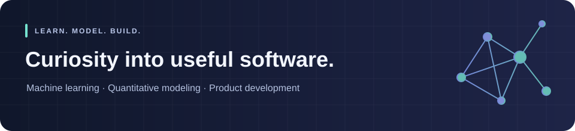

  

<h1 align="center">Hi, I'm Aarush 👋</h1>

  <strong>Computer Science &amp; Biochemistry at MIT</strong> 
  Machine learning, quantitative models, and products people can use.

  
  &nbsp;
  

## A little about me

- 🎓 I'm an MIT student studying Computer Science and Biochemistry.
- 🧠 I'm interested in interpretable ML, AI safety, and turning complex information into useful decisions.
- 🛠️ I build across machine learning, quantitative finance, iOS, and the web.
- 🌱 I'm a fellow with MIT AI Alignment (MAIA), exploring technical alignment questions and AI safety research.

## Projects to explore

### [Ripple](https://github.com/rexziywbang/ripple) · HackMIT

An event planning assistant that follows the effects of a change across venues, catering, staffing, and budgets. **My contribution focused on the landing page and product demo.**

`React` `TypeScript` `LLM applications` `MiniLM semantic search`

### [TABReady](https://github.com/rexziywbang/tabready)

A local HVAC spreadsheet review tool: import Excel readings, inspect deterministic checks, review exceptions, and generate immutable report snapshots.

`Next.js` `TypeScript` `SQLite` `Data validation`

### [Fourteen](https://github.com/rexziywbang/fourteen-app)

A SwiftUI social app prototype centered on a fourteen-day clue trail and sender-approved reveals, with a PostgreSQL/Supabase backend awaiting integration validation.

`Swift` `SwiftUI` `PostgreSQL` `Supabase`

## Languages & tools

  
  
  
  

  
  
  
  

**Machine learning:** CatBoost · Optuna · SHAP · Gaussian mixture models · Model interpretability  
**Quantitative modeling:** NumPy · SciPy · Matplotlib · Bayesian methods · Portfolio optimization · Time-series analysis · Backtesting

---

Always happy to connect about ML, AI safety, or something you're building.

